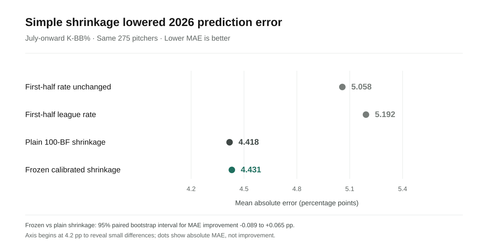

# 2026 apparent breakouts: five pitcher follow-ups

**Decision date:** June 30, 2026. **Outcome:** July-onward K-BB%. This is a retrospective forecast check, not a claim that we identified a change in true talent. The five pitchers below are the **top five by improvement over their 2025 K-BB% at the June cutoff**, using the rule written before the 2026 outcomes were examined. They are not selected for making the forecast look good.

Across 275 pitchers with at least 100 BF in both halves, the frozen forecast's mean absolute error was **4.431 percentage points**; plain 100-BF shrinkage was **4.418**, and carrying June's rate forward was **5.058**. The chart shows all four comparison methods. The frozen calibration did not establish an improvement over plain shrinkage.

## What a club would have seen at the cutoff

Every rate below is K-BB%. The prediction uses only first-half 2026 totals and the frozen formula; the final two columns were unknown on June 30. Values are rounded for presentation, so subtracting rounded rates can differ by 0.1 point from the underlying calculation.

| Pitcher | 2025 full | Through June 2026 | Forecast for July onward | Actual July onward | July BF |
|---|---:|---:|---:|---:|---:|
| Colin Holderman | 1.6% | 22.4% | 18.8% | 3.8% | 106 |
| Bryce Miller | 10.2% | 30.1% | 24.3% | 9.9% | 322 |
| Tanner Scott | 17.6% | 31.0% | 23.7% | 22.4% | 125 |
| Jhoan Duran | 21.3% | 34.5% | 25.0% | 28.6% | 126 |
| Ryan Rolison | 2.6% | 14.8% | 14.7% | 6.7% | 134 |

**Colin Holderman:** The largest June increase, about **20.8 points** over 2025, was mostly gone by July onward. His July rate of 3.8% was still technically above 2025's 1.6%, so the prespecified binary persistence label is “yes.” The forecast missed by about **15.0 points**. This is the clearest example of why “above last year” can overstate persistence.

**Bryce Miller:** His June rate was about **19.9 points** above 2025, but his July rate was **9.9%**, slightly below his 2025 rate. The forecast missed by about **14.3 points**. The large July sample of **322 BF** makes this an important forecast failure to show, though the rate alone does not explain why it happened.

**Tanner Scott:** His June increase was about **13.3 points**. July onward settled at **22.4%**: below June's 31.0%, but above 2025's 17.6%. The forecast of 23.7% missed by about **1.3 points**. Shrinkage captured the direction of regression fairly well in this case.

**Jhoan Duran:** July onward was **28.6%**, above his 2025 rate of 21.3% and below his June rate of 34.5%. The forecast of 25.0% was low by about **3.6 points**. He retained part of the early increase.

**Ryan Rolison:** July onward was **6.7%**, still above 2025's 2.6% but well below June's 14.8%. The forecast of 14.7% was high by about **8.0 points**. His “persistent” binary label also conceals substantial regression.

## Interpretation and limits

Among all **72** apparent breakouts, **60** had at least 100 July BF. **40 of those 60** finished above their 2025 rate. In an additional, post-test descriptive check, only **23 of the 60** retained at least half their June gain. The second threshold was exploratory; it should not be presented as a prespecified success rate.

These five are useful case studies, not a random sample of pitchers. Their rates cannot establish a mechanical cause, diagnose health or role changes, or prove that a club should make a transaction. The model should be read as a rate forecast with visible uncertainty from limited BF and future playing time. The complete sample and exact unrounded values are in [`frozen_2026_predictions.csv`](frozen_2026_predictions.csv); the frozen rule and aggregate results are in [`09_Frozen_2026_Protocol.md`](09_Frozen_2026_Protocol.md) and [`10_Final_2026_Test_Results.md`](10_Final_2026_Test_Results.md).
